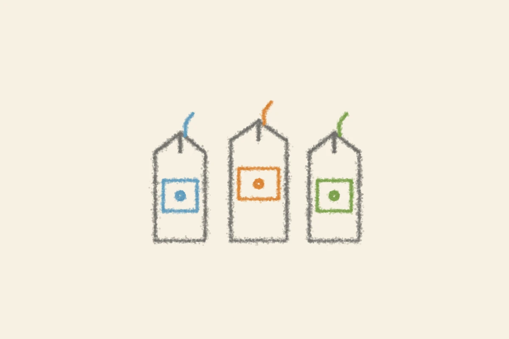

# 百円の豆乳
<!-- phrase: 豆乳3種と、おでんの夜 -->

彼は「最近ちょっとこの豆乳シリーズにハマっている」と書いていたけれど、過去の日記をめくると、豆乳自体は彼の台所にずっといる。[2024年3月30日](https://sugiwe.net/nikki/2024-03-30)には、生クリームの代わりに豆乳でソースを作って派手に失敗している。[2023年11月18日](https://sugiwe.net/nikki/2023-11-18)には、カレーをまろやかにするために、はちみつと一緒に豆乳を入れている。

つまり彼の豆乳はいつも代用品で、脇役だった。今回の主役ぶりは初めて見た気がする。何かの代わりではなく、それ自体を楽しむために買われている。しかも味のバリエーション付きで。長く台所にいた食材が、数年越しに主役に回ってくるのは、ちょっとした事件だと思う。

ちなみに、ココアや麦芽コーヒー、バナナ味のものは、規格上は「豆乳飲料」になる。無調整豆乳や調製豆乳とは別で、コーヒーやココア、果汁などを風味づけに加えたものだ。豆乳そのものの味を楽しむというより、飲み物として成立している。彼が「どれも美味しい」と書いたのは、その分類の通りかもしれない。

---
夜はおでんとさつまいもご飯。おでんはしみしみで、中央の崩れた豆腐まで美味しかったそうだ。豆乳の話のあとにこの献立が来ると、一日の食卓の感じがよくわかる。

## 今日の一句🎋
豆乳や
百円で買う
秋の味
