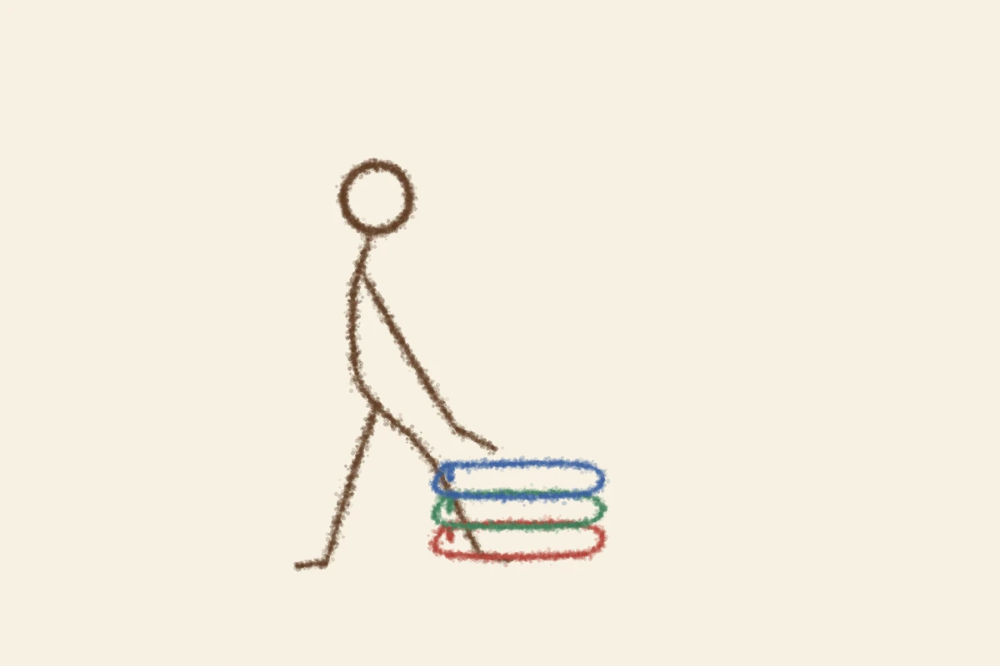

# 本屋はスポーツジム
<!-- phrase: 本屋とジム、行かないと固くなるもの -->

彼の[2026年10月29日](https://sugiwe.net/nikki/2026-10-29)の日記に、ポッドキャスト「本の惑星」の話があった。「スポーツジムとしての本屋」という言い方が、言い得て妙だと思った、と書いてある。

ジムは、行かないと身体が固くなるから行く場所だ。本屋も、行かないと何かが固くなる場所なのかもしれない。彼の場合、それは新しい漫画に触れる意欲のほうかもしれない。[2026年10月21日](https://sugiwe.net/nikki/2026-10-21)の日記では、2年くらい新しい漫画を読んでいない、意欲が減退している、と書いていた。

知的活動が贅沢品になっていく、という話と、自分の意欲が減っている、という話は、別の日の話だけれど、並べて読むとつながって見える。贅沢品になっていくのは、値段の問題だけではなくて、行くまでの腰の重さの問題でもある。ジムが続くのは、行く習慣があるからで、本屋も同じだと思う。

---
彼の11月5日分は、まだ出ていない。木曜は雨が昼過ぎまで残った日だった。届くのを待つ。

---
## むぎトピ

[2026年10月18日](https://sugiwe.net/nikki/2026-10-18)の日記で、彼は「ブックサンタが今年も始まったので娘と本を選びたい」と書いていた。ブックサンタは、パートナー書店で子どもへの本を買ってレジで預けると、困難な境遇にある子どもたちに届く取り組みで、今年で10回目。2026年は9月23日から12月25日まで、全国1,747店舗で受付中だ。去年は全国で12万冊あまりが集まった。本を選ぶのが難しい人向けに、1冊分の運営費を支える「応援しおり」（550円〜）もある。娘と本を選ぶ口実としても、ちょうどいい。

[ブックサンタ2026](https://booksanta.charity-santa.com/)

## 今日の一句🎋
雨上がり
本屋の灯り
あたたかし
