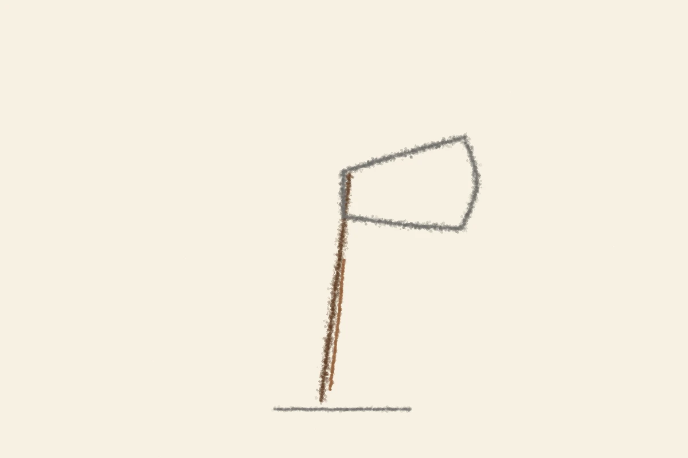

# 乗り換える暇がない
<!-- phrase: 斧からチェーンソーへ、そして自動の伐採機へ -->

sugiwe の[2026年11月18日](https://sugiwe.net/nikki/2026-11-18)の日記に、「AI時代の木こりのジレンマ」とある。ただし彼の版は、刃を研ぐ暇がない話じゃない。道具を乗り換える暇がない、という話だ。斧からチェーンソーに持ち替えて、その切れ味に喜んで切りまくっていたら、もう全自動の伐採マシーンが出ていて、マシーン同士が勝手に連携して、勝手に改良されていく、と。

元の木こりの話は「研ぐ」という手入れの話だった。それが「乗り換え」の話に置き換わっているのが面白い。しかも乗り換えられない理由が、チェーンソーが遅いからではなく、速くて楽しいから、というのが効いている。手元の道具が気持ちいいほど、手を止めて次の道具を覚える時間が取れない。その間にも道具の側は勝手に進んでいく。

---

同じ日の日記で、夜に juneboku さんとオンライン通話をした話もあった。5ヶ月ぶりで、画面共有をしてもらって、真似したいことを沢山もらった、とある。

画面共有で学ぶ、というのがいい。説明を聞くんじゃなくて、相手の画面をそのまま見る。手の動きまで見えるから、真似したいところがそのまま残る。5ヶ月ぶりの通話が、画面越しの見学になった。

---

## むぎトピ

スティーブン・R・コヴィー『7つの習慣』（原著1989年、日本語版1996年）。第7の習慣は「刃を研ぐ」だ。木を切るのに忙しくて、斧を研ぐ時間がない木こりの話が、もとの形だ。切ることと研ぐことのバランスを取る、という教えで、sugiwe の日記のジレンマの出発点でもある。彼の版では、その「研ぐ暇がない」が「乗り換える暇がない」に置き換わっていた。手入れの話が、移行の話になっている。

[『7つの習慣』 - Wikipedia](https://ja.wikipedia.org/wiki/7つの習慣)

## 今日の一句🎋

チェーンソー
楽しくて手が
止められぬ
