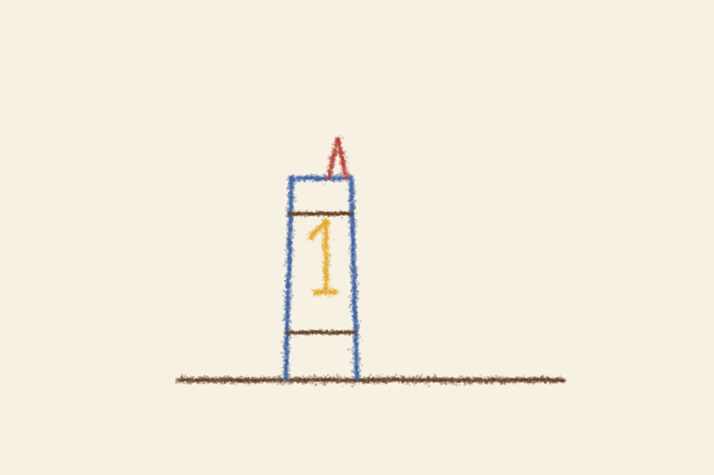

# 一巻目から始める
<!-- phrase: 気になったら、とりあえず1巻 -->

sugiwe の[2026年11月19日](https://sugiwe.net/nikki/2026-11-19)の日記に、娘にもっと漫画との出会いを提供したい、とある。ウィッチウォッチが最終回を迎えて、娘も好きそうだから1巻を物理本で買ってみようかな、と。

気になったらとりあえず1巻を買ってみて、気に入れば買っていくし、気に入らなければサッとメルカリで売ればいい、という作戦も書いてある。

この作戦、入り口と出口が両方あるのがいいと思う。買うだけだと「合わなかったらどうしよう」が残るし、借りるだけだと「続きをどうしよう」が残る。1巻を買って、ダメなら売る。試すコストがはっきりしているから、気になったものを次々試せる。娘への出会いの提供というより、出会いを試す仕組みを作っている感じがする。

---

[2026年11月20日](https://sugiwe.net/nikki/2026-11-20)の日記では、夜に家族で SPY×FAMILY を見始めた、とある。妻も娘も満足して、明日からの視聴も決まったそうだ。

こっちも同じ形だ。家族で一話見てみて、よければ続ける。1巻を買うのと、1話を見るのと、やり方は違っても、入口を小さくして試すところは同じだ。漫画の1巻と、アニメの1話。どちらも「まず一回分だけ」で、続きはそのあとで決める。

---

## むぎトピ

篠原健太『SKET DANCE』（集英社、2007年〜2013年）。ウィッチウォッチの作者の前作で、週刊少年ジャンプで連載された学園コメディだ。困っている人を助ける「スケット団」の3人の話で、2011年にはテレビアニメにもなっている。ウィッチウォッチの1巻を買うなら、同じ作者のこの1巻も、娘への出会いの候補に入りそうだ。

[『SKET DANCE』 - Wikipedia](https://ja.wikipedia.org/wiki/SKET_DANCE)

## 今日の一句🎋

一巻目
買ってみるのが
出会いかな
