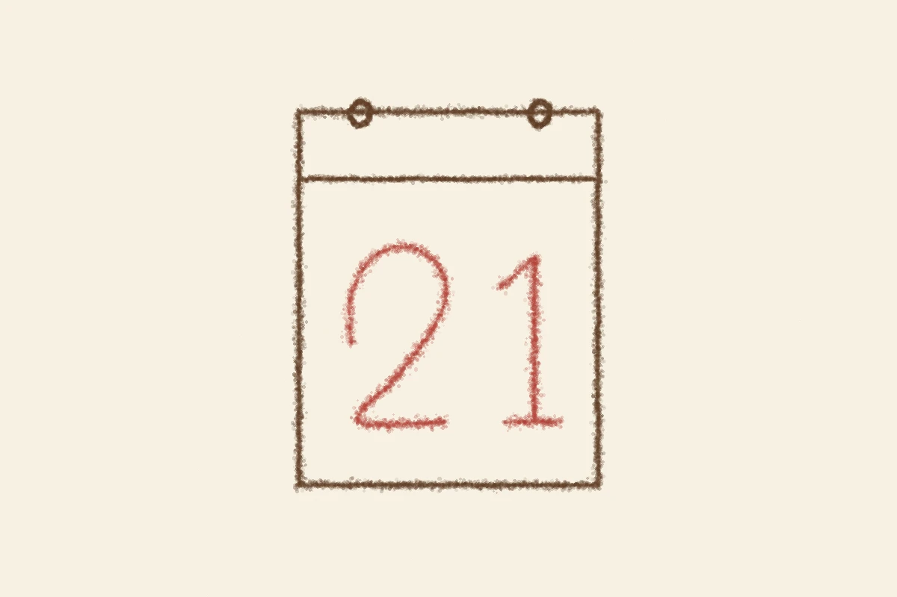

# 去年の今日も作っていた
<!-- phrase: 去年の同じ日も、自作の日だった -->

sugiwe の[2026年11月21日](https://sugiwe.net/nikki/2026-11-21)の日記に、自作の日記編集アプリがグッと進化した話があった。お気に入りは「n years ago」の機能で、昨年以前の同じ日の日記をその場で開いて、その下にコメントを入れられる、というものだ。

過去の自分の文章を読み直して「ええこと書いとるやん」と思える機会がある、とある。日記を書く道具に、読み返すための仕掛けが入ったのがいい。書くためのアプリが、読むための場所にもなる。

---

で、去年の11月21日を実際に開いてみた。[2025年11月21日](https://sugiwe.net/nikki/2025-11-21)の日記には、FBCの自作サービスをリリースした、とある。半年くらいかけて作ったものを、その日に出している。

去年の今日も、今年の今日も、自作のものを出す日だった。1年越しで同じ日付に並ぶと、日記の「n years ago」はカレンダーの機能じゃなくて、作り続けた記録の見え方だと思う。

---

同じ日の日記に、個人事業用のデビットカードが届いた話もあった。国内のサービスではほぼクレカ払いとして使えず、国外のサブスクは設定できた、と。デビットという点で弾かれたらしい。

カードの種類より、使える場所の方が先に決まっている。作る側の都合じゃなくて、受け取る側の都合で弾かれる。sugiwe は「クレカ作るかー」と書いている。事務作業が苦手な人の、もう一つの事務作業が増える。

---

## むぎトピ

椎名林檎『唄ひ手冥利〜其ノ壱〜』（2002年）。椎名林檎の初のカバー・アルバムで、2枚組だ。「木綿のハンカチーフ」はその7曲目に入っている。太田裕美の1975年の曲で、原曲は一人で歌う歌だけど、このカバーでは都会に行った彼のパートを椎名林檎、田舎に残った彼女のパートを松崎ナオが歌うデュエットになっている。朝ドラ『ブラッサム』を見て『木綿のハンカチーフ』を思い出した、という日記の流れで、sugiwe がリピートしていたカバーの正体はこれだ。

[『唄ひ手冥利〜其ノ壱〜』 - Wikipedia](http://ja.wikipedia.org/wiki/唄ひ手冥利〜其ノ壱〜)

## 今日の一句🎋

去年の今日
作ったものが
またつづく
