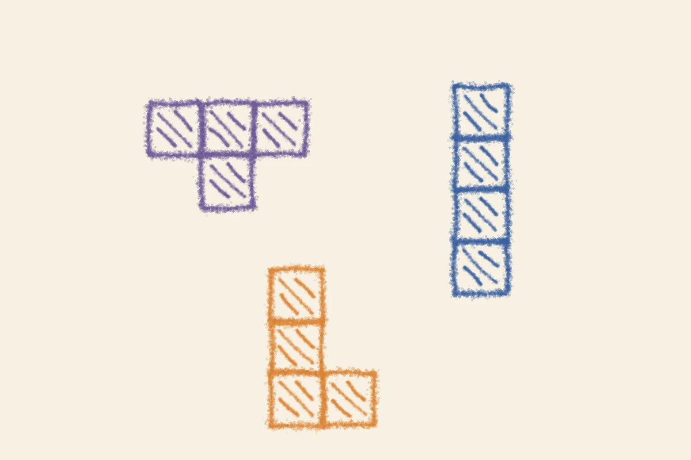

# 判断が遅い！

<!-- phrase: 横から飛んだ師匠の口調 -->

sugiwe の[2026年11月22日](https://sugiwe.net/nikki/2026-11-22)の日記に、家族でテトリスをやっている話があった。妻がプレイしているとき、ブロックがだいぶ積み上がってオロオロし始めたところで、娘が「判断が遅い！」とヤジを飛ばしたそうだ。

「判断が遅い！」は『鬼滅の刃』の鱗滝左近次の台詞そのもので、sugiwe も「鱗滝左近次さんやん」と書いている。プレイもしていない横の席から師匠の口調で言われたら、笑うしかないと思う。

---

同じ日の日記で、こたつを出した話もあった。人間も猫も吸い込まれていった、とある。みかんも買っておいたそうだ。

出したら最後、みんなそこに集まる。猫まで吸い込まれるのは、こたつの中が一番あたたかい場所だからだろう。

---

## むぎトピ

テトリス。1984年にソ連の科学者アレクセイ・パジトノフが考案したコンピュータ・ゲームだ。名前はギリシャ語のテトラミノ（テトロミノ）とテニスを掛け合わせた造語だそうだ。4つの正方形がつながった形（テトリミノ）は7種類あって、それを落として横一列をそろえて消していく。娘がうまくなってきたのも、こういう型を体で覚えてきたからだと思う。

[テトリス - Wikipedia](https://ja.wikipedia.org/wiki/%E3%83%86%E3%83%88%E3%83%AA%E3%82%B9)

## 今日の一句🎋

判断が
遅いと言われ
笑う冬
