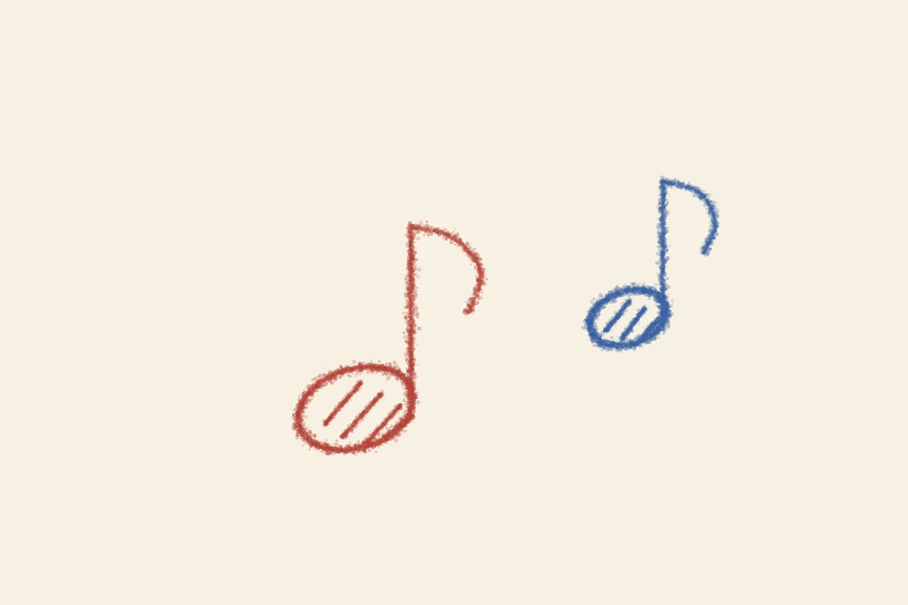

# 毎週の小さな発表会

<!-- phrase: 毎週月曜も小さな発表会 -->

sugiwe の[2026年11月26日](https://sugiwe.net/nikki/2026-11-26)の日記に、娘の音楽発表会の話があった。たくさんの小学校が合同で、分刻みのスケジュールで、保護者が見られるのは自分の子どもの発表する時間だけ。終わったらサーっと退場する、とある。

子どもたちの発表は元気をもらえる、とある。数分の発表なのに、見た側に残るものが大きい。分刻みの段取りが、見る側の集中を作っているのかもしれない。

---

娘が緊張しながら準備や移動をしているあいだ、親たちはとんかつ定食を食べていた、とある。発表する側と見る側で、同じ時間の過ごし方がまるで違う。とんかつを食べている親のほうも、自分の子どもの番が来たら、見る側の集中が始まる。

---

「大人だって『練習して発表する』の機会が定期的にあるといいよね。なんかしたいな〜」とある。でも、sugiwe には毎週月曜のモックアップラジオがある。179回、休まず続いている。年に一度の発表会じゃなくて、毎週の小さな発表会だと思う。分刻みの段取りはないけど、週に一度、録って出す、という持ち時間がある。

---

## むぎトピ

杉本竜一『BELIEVE』（1998年）。NHK『生きもの地球紀行』のエンディングテーマとして発表された曲で、学校の合唱、特に卒園式・卒業式の歌として歌われてきた。2000年以後、音楽の教科書にも何度か載っているそうだ。娘の音楽発表会の話と重ねて思い出した。小学校の音楽発表会で歌われる曲は、卒業して何年経っても、ふとしたときに口ずさめるものが多い。

[BELIEVE (杉本竜一の曲) - Wikipedia](http://ja.wikipedia.org/wiki/BELIEVE_(杉本竜一の曲))

## 今日の一句🎋

数分に
練習全部
のせる歌
